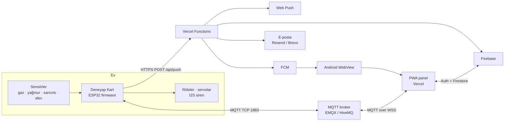
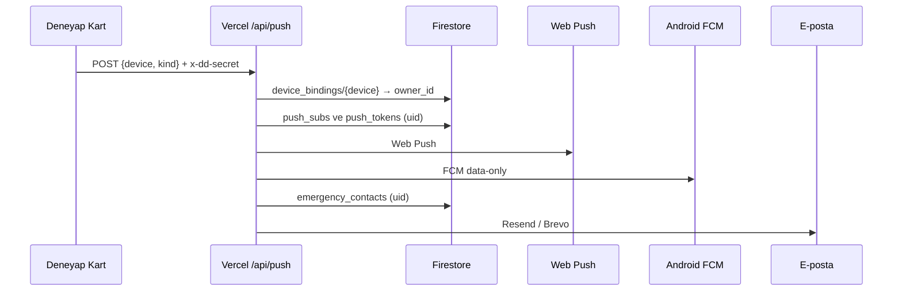

# DD Ev Koruma

<p align="center">
  
</p>

**ESP32 tabanlı ev güvenlik sistemi:** MQTT firmware + PWA kontrol paneli + Vercel
sunucusuz API + Firebase/Firestore + Android WebView kabuğu.

[Canlı panel](https://ddproje.vercel.app/) ·
[Android dokümanı](README-ANDROID.md) ·
[Firebase dokümanı](FIREBASE.md) ·
[Play Store kontrol listesi](PLAY-STORE.md) ·
[Tasarım notları](DESIGN.md) ·
[Sorun bildir](https://github.com/mabiltekin-droid/dd-deneyap-proje/issues)

> **Sürümler:** PWA `2.23.0` · Android `2.23.0` (`versionCode 4`) · MQTT firmware
> `3.4.0` · Legacy HTTP/AP firmware `2.23.0`.
>
> Bu README, hem insan okuyucular hem de yapay zekâ ajanları için yapılandırılmıştır.
> Dosya yolları, komutlar, portlar, koleksiyon adları ve sürümler kaynak koddan
> doğrulanmıştır. Gizli anahtar, parola veya servis hesabı içermez.

---

## İçindekiler

1. [Proje özeti](#ozet)
2. [Proje durumu](#durum)
3. [Sistem mimarisi](#mimari)
4. [Dizin yapısı](#dosyalar)
5. [Donanım ve kablolama](#donanim)
6. [Firmware](#firmware)
7. [PWA kontrol paneli](#pwa)
8. [Firebase ve Firestore](#firebase)
9. [Vercel API](#api)
10. [Android uygulaması](#android)
11. [Kurulum](#kurulum)
12. [İlk kullanım ve cihaz bağlama](#kullanim)
13. [Test ve doğrulama](#test)
14. [Güvenlik](#guvenlik)
15. [Sorun giderme](#sorun)
16. [Bilinen sınırlamalar](#sinirlar)
17. [Katkı](#katki)
18. [Lisans](#lisans)
19. [Sözlük](#sozluk)

---

<a id="ozet"></a>
## 1. Proje özeti

Deneyap Ev Koruma, **Deneyap Kart 1A v2 (ESP32)** üzerinde çalışan bir ev güvenlik
istasyonudur. Kart; gaz/duman, yağmur/su baskını, sarsıntı ve alev algılar. Algılanan
duruma göre fanı, su motorunu, pencere servosunu ve panjur servosunu kontrol eder;
gerekirse I2S hoparlörden siren çalar.

Cihaz, MQTT üzerinden internete açılan bir konuya durum yayınlar. PWA paneli aynı
konuya WebSocket ile bağlanır. Panel kapalıyken bile alarm gitmesi gerektiğinde cihaz
Vercel’deki `/api/push` uç noktasına HTTPS isteği atar; bu uç nokta Web Push, Android
FCM ve acil durum e-postalarını gönderir.

Android uygulaması ayrı bir arayüz değildir: canlı PWA’yı **tam ekran WebView** içinde
açar. Web’de yapılan değişiklikler yeni APK üretmeden uygulamaya yansır. APK yalnızca
Android kabuğu (ikon, paket, izin, sürüm, başlangıç adresi, yerel Java kodu) değişince
yeniden üretilir.

### 1.1. Kısa anlatım

> Evdeki kart sensörleri okur. Gaz tehlikesi varsa fanı açar, su motorunu kilitler,
> pencereyi kapatır ve siren çalar. Yağmur başlarsa pencereyi kapatır. Sarsıntı veya
> alev varsa alarm verir. Panelde canlı durum, geçmiş grafik, olay günlüğü ve ayarlar
> bulunur. Telefon kapalıyken bile alarm; FCM, Web Push veya e-posta ile iletilir.

### 1.2. Ne yapar?

| Alan | Yapabildikleri |
|---|---|
| Sensörler | MQ-2 gaz/duman, yağmur/su baskını, SW-420/801S sınıfı sarsıntı, IR alev |
| Aktüatörler | 2 röle (fan + su motoru), 2 servo (pencere + panjur), I2S hoparlör |
| Otomasyon | Gaz tehlikesinde fan/tahliye, pompa kilidi, pencere kapatma, siren |
| Haberleşme | MQTT (cihaz TCP 1883, panel WSS), yerel HTTP JSON API |
| Panel | Canlı telemetri, grafik, modlar, eşikler, otomasyon, olay günlüğü |
| Hesaplar | Firebase Auth, e-posta/şifre, Google/GitHub/Apple, roller, davetler |
| Cihaz sahipliği | Aktivasyon koduyla bağlama, admin onaylı bağlantı kesme |
| Bildirim | Tarayıcı bildirimi, Web Push, Android FCM, Telegram, e-posta |
| Raporlama | CSV, Android’de A4 PDF, tarayıcıda yazdırma, kara kutu oynatıcı |
| Dayanıklılık | Son telemetri önbelleği, çevrimdışı şerit, servis çalışanı önbelleği |
| Güncelleme | USB ve kablosuz (ArduinoOTA) firmware yükleme |

### 1.3. Ne yapmaz?

- **Sıcaklık/nem ölçmez.** Projede DHT/SHT sıcaklık-nem sensörü yoktur. Panelde
  sıcaklık veya nem alanı gösterilmez.
- **Sertifikalı yangın/gaz alarm cihazı değildir.** Eğitim ve hobi prototipidir;
  hayati güvenlik için sertifikalı, bakımlı bir sistemin yerine geçmez.
- **Telefon/SMS ile giriş yapmaz.** Telefon numarası ve SMS doğrulaması kapsam dışıdır.
- **Gerçek iki faktörlü kimlik doğrulama (TOTP/SMS MFA) sunmaz.** Bunun yerine
  sunucu tarafında “taze giriş” (step-up) ve oturum sertleştirme vardır.
- **Çevrimdışıyken cihazı kontrol etmez.** Önbellekteki son telemetri görüntülenir;
  kumanda için MQTT/HTTP bağlantısı gerekir.
- **Aynı anda birden çok cihazla konuşmaz.** Panel aynı anda tek MQTT konusuna
  bağlanır; cihazlar arasında geçiş yapılır.
- **Kamera, video veya bulut yapay zekâsı içermez.**
- **Cloud Functions kullanmaz.** Sunucu tarafı Vercel Serverless Functions’tır.

### 1.4. Tasarım kararları

| Karar | Gerekçe |
|---|---|
| WebView-first Android | Tek kod tabanı; web güncellemesi APK gerektirmez |
| Tek evrensel APK | Telefon/tablet ayrımı yok; PWA responsive |
| MQTT varsayılan | HTTPS panelden cihaza doğrudan bağlantıda mixed-content sorunu yok |
| HTTP/AP yalnızca yerel | `http://192.168.4.1` üzerinden kurtarma ve ilk kurulum |
| Firestore | Auth, roller, cihaz sahipliği, olaylar ve push kayıtları tek yerde |
| FCM data-only | Bildirimi Android tarafı yerel olarak çizer; WebView’e bağlı değildir |
| Vercel + Brevo/Resend | Cloud Functions ve ayrı sunucu bakımı gerekmez |
| GitHub Actions yok | Doğrulama yerel `npm` komutlarıyla yapılır; istenmedi |
| Açık tema varsayılan | “Sakin ev” görsel yönü; koyu/AMOLED isteğe bağlı |
| Dekoratif shader’lar kapalı | Gereksiz GPU yükü ve pil tüketimini önler |

---

<a id="durum"></a>
## 2. Proje durumu

### 2.1. Durum tablosu

| Bileşen | Durum | Not |
|---|---|---|
| PWA paneli | ✅ Üretimde | `https://ddproje.vercel.app/` |
| Firebase Auth + Firestore | ✅ Kurulu | Proje `ddproje-9f594` |
| Firestore kuralları/indeksleri | ✅ Yayınlandı | `firestore.rules`, `firestore.indexes.json` |
| Acil durum kişileri | ✅ Hazır | Firestore CRUD + test e-postası |
| Test e-postası | ✅ Doğrulandı | Brevo sağlayıcısıyla başarılı |
| Android FCM kodu | ✅ Hazır | Uçtan uca teslim gerçek token ile doğrulanmalı |
| Gerçek alarm e-postası | ⏳ Bekliyor | Cihaz bağlama + firmware `PUSH_SECRET` gerekir |
| Android APK/AAB | ✅ Derlendi ve imzalandı | Play yüklemesi bekliyor |
| Play Store yayını | ⏳ Bekliyor | Play Console hesabı ve mağaza girişi gerekir |
| MQTT firmware | ✅ Derlendi | Son sürüm fiziksel karta yüklenmedi |
| Donanım montajı | ⏳ Bekliyor | Bu geliştirme ortamında kart bağlı değil |
| WebView içinde Google girişi | ⚠️ Doğrulanmadı | Chrome’da aç yedeği mevcut |
| Telefon/SMS girişi | — | Kapsam dışı, ertelendi |
| GitHub Actions CI | — | Bilinçli olarak yok |

### 2.2. Doğruluk kaynakları

Bu README’deki bilgiler aşağıdaki dosyalarla çapraz kontrol edilmiştir:

| Konu | Kaynak |
|---|---|
| Web sürümü | `package.json`, `pwa/js/config.js`, `pwa/sw.js` |
| Android sürümü | `android/gradle.properties` |
| Firmware sürümü | `firmware-mqtt/DeneyapEvKoruma/config.h` |
| Firestore güvenliği | `firestore.rules` |
| Firestore indeksleri | `firestore.indexes.json` |
| Vercel dağıtımı | `vercel.json` |
| API uçları | `api/push.js`, `api/notify.js`, `api/digest.js`, `api/_lib.js` |
| Android kabuğu | `README-ANDROID.md` ve Java kaynakları |
| Firebase kurulumu | `FIREBASE.md` |
| Play yayını | `PLAY-STORE.md` |
| Görsel yön | `DESIGN.md` |

### 2.3. Sürüm ve ortam bilgileri

| Alan | Değer |
|---|---|
| Web/PWA sürümü | `2.23.0` |
| Service Worker önbelleği | `deneyap-pwa-v2.23.0-r1` |
| Android sürümü | `2.23.0` / `versionCode 4` |
| Android paket adı | `com.mabiltekin.deneyapevkoruma` |
| minSdk / targetSdk | `24` (Android 7.0+) / `36` (Android 16) |
| MQTT firmware | `3.4.0` |
| Legacy HTTP/AP firmware | `2.23.0` |
| Firebase projesi | `ddproje-9f594` |
| Vercel projesi | `mustafas-projects-d10af73b/ddproje` |
| Üretim adresi | `https://ddproje.vercel.app/` |
| Node.js | `>=18` |
| Java / Gradle | JDK 17 / Gradle 8.11.1 |
| ESP32 çekirdeği | Arduino ESP32 core `3.3.10` (3.3.x) |
| MQTT kütüphanesi | `PubSubClient 2.8` |
| MQTT FQBN | `esp32:esp32:deneyapkart1Av2` |
| Legacy FQBN | `esp32:esp32:deneyapkartv2` |

> PWA, Android ve firmware sürümleri birbirinden bağımsızdır. PWA sürümü
> `package.json`, `config.js` ve `sw.js` içinde aynı olmalıdır; `npm run check`
> bunu denetler.

---

<a id="mimari"></a>
## 3. Sistem mimarisi

### 3.1. Bileşenler

| Bileşen | Teknoloji | Görev |
|---|---|---|
| Cihaz | Deneyap Kart 1A v2 / ESP32 | Sensör okuma, otomasyon, MQTT, HTTP, OTA |
| Sensörler | MQ-2, yağmur, SW-420/801S, IR alev | Gaz, su, sarsıntı, alev |
| Aktüatörler | 2 röle, 2 servo, MAX98357A + hoparlör | Fan, pompa, pencere, panjur, siren |
| Broker | `broker.emqx.io` (birincil), `broker.hivemq.com` (yedek) | MQTT mesajlaşması |
| Panel | Vanilla JS PWA, Canvas, Service Worker | Telemetri, kontrol, ayar, rapor |
| Kimlik/veri | Firebase Auth + Cloud Firestore | Hesaplar, roller, sahiplik, olaylar |
| Sunucu | Vercel Serverless Functions | Push, e-posta, haftalık özet |
| Android | Java WebView + FCM | Tam ekran panel, bildirim, widget, PDF |
| E-posta | Resend veya Brevo | Acil durum e-postaları |
| Anlık mesaj | Telegram Bot API | Cihazdan doğrudan alarm mesajı |

### 3.2. Genel akış



### 3.3. Normal telemetri akışı

1. Firmware sensörleri okur, EMA filtresi ve histerezis uygular.
2. Durum JSON’u 3 saniyede bir `<T>/status` konusuna **retained** yayınlanır.
3. Panel WebSocket üzerinden aynı konuya abonedir; son durumu alır.
4. Panel 12 saniye yeni veri gelmezse cihazı bayat/çevrimdışı sayar.
5. Panel son telemetriyi `localStorage`’a yazar; ağ kesilirse önbellekten gösterir.
6. Cihaz geçmişi 60 saniyede bir örnekle 24 saatlik RAM halkasında tutar.

### 3.4. Alarm akışı



- Cihaz yalnızca `device` ve `kind` gönderir.
- `uid` istekte yoksa Vercel, `device_bindings/{device}` üzerinden sahibi bulur.
- Bağlama kaydı yoksa e-posta gönderilmez; Web Push/FCM eski davranışla tüm
  abonelere gidebilir.
- Aynı tür alarm cihaz tarafında 30 saniyede bir tetiklenir; spam engeli vardır.

### 3.5. Taşıma katmanları

| Taşıma | Nerede çalışır? | Artı | Eksi |
|---|---|---|---|
| `mqtt` | İnternet üzerinden, WSS | HTTPS panelde mixed-content yok; uzaktan erişim | Ortak broker varsayılan; cihaz tarafı TCP 1883 şifresiz |
| `http` | Yalnızca cihazın kendi ağı | Basit, broker gerekmez | `https` panelden çağrılamaz; AP modunda internet yok |

Panel varsayılan olarak `mqtt` kullanır. `http` yalnızca `http://192.168.4.1`
gibi yerel adreslerden açıldığında anlamlıdır. HTTPS üzerinden HTTP’ye istek
tarayıcı tarafından engellenir; panel bu durumda otomatik olarak MQTT’ye yönlendirir.

### 3.6. Çoklu cihaz modeli

- Panel aynı anda **tek** MQTT konusuna bağlanır.
- Her cihazın kimliği (`DK-XXXX` veya `DEVICE_ID`) ve MQTT konusu eşlenir.
- Cihaz seçildiğinde panel o cihazın konusuna yeniden bağlanır.
- Konu bilgisi hem tarayıcıda (`deviceTopics`) hem `device_bindings.topic` alanında
  tutulur.
- Aynı anda iki evi tek ekranda birleştiren bir “dashboard” yoktur.

### 3.7. Neden WebView-first?

- Tek PWA kod tabanı; Android ve masaüstü aynı arayüzü kullanır.
- Web güncellemesi için yeni APK gerekmez.
- Chrome Custom Tabs yalnızca “Chrome’da aç”, Google girişi yedeği ve web push
  için devreye girer.
- WebView’de çalışmayan Web Push’un yerini yerel FCM alır.
- Tek evrensel APK; telefon/tablet için ayrı paket gerekmez.

---

<a id="dosyalar"></a>
## 4. Dizin yapısı

```text
dd-deneyap-proje/
├─ pwa/                          # PWA kaynakları (asıl kaynak)
│  ├─ index.html                 # Dashboard / kokpit
│  ├─ settings.html              # Ayar stüdyosu
│  ├─ privacy.html               # Gizlilik ve hesap silme
│  ├─ manifest.json              # PWA manifest
│  ├─ sw.js                      # Service Worker + önbellek
│  ├─ css/                       # style, mobile-app, redesign
│  ├─ fonts/                     # DM Sans + Fraunces (yerel)
│  ├─ icons/                     # PWA ikonları
│  └─ js/                        # Panel modülleri (aşağıda)
├─ api/                          # Vercel Serverless Functions
│  ├─ _lib.js                    # Firebase Admin, Web Push, FCM, e-posta
│  ├─ push.js                    # /api/push
│  ├─ notify.js                  # /api/notify
│  └─ digest.js                  # /api/digest (haftalık özet)
├─ android/                      # Android WebView kabuğu
│  ├─ app/src/main/java/...      # Java kaynakları
│  ├─ app/src/main/res/          # İkon, widget, kısayol, tema
│  ├─ play/                      # Play görselleri
│  ├─ dist/                      # APK/AAB çıktıları (git dışı)
│  └─ gradle.properties          # URL, paket, sürüm
├─ firmware-mqtt/                # Aktif MQTT firmware
│  ├─ DeneyapEvKoruma/
│  │  ├─ DeneyapEvKoruma.ino
│  │  ├─ config.h
│  │  ├─ config.local.example.h
│  │  └─ README.md
│  └─ README.md
├─ firmware/                     # Legacy HTTP + Access Point firmware
│  ├─ firmware.ino
│  └─ config.h
├─ tools/                        # Derleme, test, geliştirme araçları
├─ tests/                        # MQTT taşıma testi
├─ supabase/                     # Legacy/opsiyonel Supabase şeması
├─ firestore.rules               # Firestore güvenlik kuralları
├─ firestore.indexes.json        # Bileşik indeksler
├─ firebase.json                 # Firebase CLI yapılandırması
├─ .firebaserc                   # Firebase proje kimliği
├─ vercel.json                   # Vercel build, header, cron
├─ package.json                  # npm script’leri ve bağımlılıklar
├─ README-ANDROID.md             # Android ayrıntıları
├─ FIREBASE.md                   # Firebase kurulumu
├─ PLAY-STORE.md                 # Play yayın kontrol listesi
├─ DESIGN.md                     # Görsel tasarım yönü
└─ README.md                     # Bu dosya
```

### 4.1. PWA JavaScript modülleri

| Dosya | Görev |
|---|---|
| `config.js` | Sürüm, varsayılanlar, Firebase web config, VAPID public key |
| `theme-boot.js` | İlk boyamadan önce temayı uygular (FOUC önleme) |
| `api.js` | HTTP/MQTT taşıma seçimi, durum ve komut köprüsü |
| `mqtt.js` | MQTT bağlantısı, birincil/yedek broker, yeniden bağlanma |
| `app.js` | Dashboard, telemetri, kokpit, alarm bildirimleri |
| `devices.js` | Çoklu cihaz seçimi ve konu eşlemesi |
| `offline.js` | Son telemetri önbelleği ve çevrimdışı şerit |
| `notify.js` | Yerel bildirim + Web Push aboneliği |
| `native-push.js` | Android FCM token köprüsü, canlı durum, widget |
| `firebase.js` | Firestore/Auth SDK sarmalayıcısı |
| `auth-firebase.js` | Oturum, roller, cihaz bağlama, davetler |
| `settings.js` | Ayar formları, eşikler, Telegram, bildirimler |
| `studio-nav.js` | Ayarlar bölüm menüsü ve panel yönlendirme |
| `events.js` | Olay günlüğü, CSV, PDF modeli |
| `history.js` | Geçmiş grafiği, yerel örnekleme |
| `automation.js` | Evde/gece/tatil modları ve zamanlama |
| `blackbox.js` | 60 sn öncesi + 60 sn sonrası olay kaydı |
| `emergency.js` | Acil durum e-postaları arayüzü |
| `account.js` | Hesap, giriş, kayıt, şifre |
| `profile-ui.js` | Profil, oturum güvenliği, şifre değiştirme |
| `admin-invite-ui.js` | Davet oluşturma/iptal |
| `voice.js` | Türkçe konuşma sentezi ve sesli komut |
| `tier.js` | Donanım profili (low/mid/ultra), FPS ve pil |
| `parallax.js` | Hafif hareket efektleri |
| `shaders.js` | Dekoratif WebGL; varsayılan kapalı |

### 4.2. Git dışında tutulanlar

- `firmware/secrets.h`
- `firmware-mqtt/DeneyapEvKoruma/config.local.h`
- `firmware-mqtt/DeneyapEvKoruma/secrets.h`
- Not: legacy `firmware/config.h` depoda placeholder değerlerle izlenir; gerçek
  Wi-Fi/parola değerlerini bu dosyaya yazmayın.
- `android/keystore.properties`, `android/*.jks`, `android/*.keystore`
- `android/local.properties`, `android/dist/`, `*.apk`, `*.aab`
- `.vapid.json`
- `serviceAccountKey*.json`
- `public/` (üretilen çıktı)
- `node_modules/`, `build/`, `.pio/`, `.gradle/`

---

<a id="donanim"></a>
## 5. Donanım ve kablolama

### 5.1. Malzeme listesi

| Bileşen | Görev | Not |
|---|---|---|
| Deneyap Kart 1A v2 | Ana kontrolcü | ESP32, Wi-Fi, ADC, I2S |
| MQ-2 modülü | Gaz / duman | Analog AO; ısınma süresi gerekir |
| Yağmur sensörü | Yağmur / su baskını | Ters mantıklı modül; kalibre edilir |
| SW-420 / 801S sınıfı | Sarsıntı / kurcalama | DO ve/veya AO |
| IR alev sensörü | Alev / yangın | KY-026 / LM393 sınıfı; aktif düşük |
| 2 kanallı röle modülü | Fan + su motoru | Transistör/optokopler, aktif yüksek |
| 2 servo | Pencere + panjur | 5 V ayrı besleme önerilir |
| MAX98357A | I2S amfi | 5 V, hoparlör çıkışı |
| Hoparlör | Siren / bip | 4–8 Ω |
| 5 V güç kaynağı | Servo/röle/amfi | Yeterli akım; ortak toprak |

### 5.2. MQTT firmware pin haritası

| İşlev | Deneyap adı | GPIO | Açıklama |
|---|---|---|---|
| MQ-2 AO | `A5` | `33` | Gaz/duman analog; ADC1 |
| Yağmur AO | `A1` | `39` | Yağmur analog; ADC1 |
| Sarsıntı DO | — | `14` | Dijital; aktif düşük |
| Sarsıntı AO | `A4` | `32` | Opsiyonel analog; ADC1 |
| Alev DO | — | `4` | Dijital; aktif düşük |
| Alev AO | `A0` | `36` | Opsiyonel analog; ADC1 |
| Fan rölesi | — | `13` | Aktif yüksek |
| Su motoru rölesi | — | `27` | Aktif yüksek; gazda kilitli |
| Pencere servosu | — | `25` | 50 Hz, 500–2400 µs |
| Panjur servosu | — | `26` | 50 Hz, 500–2400 µs |
| I2S BCLK | `D6` | `18` | MAX98357A BCLK |
| I2S LRC | `D5` | `19` | MAX98357A LRC/WS |
| I2S DIN | `D4` | `21` | MAX98357A DIN |
| I2S SD | — | `-1` | Bağlı değil |
| Buzzer | — | `-1` | Devre dışı; ses I2S’den |
| Durum LED’i | — | `-1` | Kart üstü LED kullanılmıyor |

> Pin adları Deneyap Kart baskısına göre değişebilir. **GPIO numarasını** esas alın;
> `config.h` içindeki `PIN_*` tanımlarını kendi kartınıza göre doğrulayın.

### 5.3. Kablolama kuralları

- **ADC1 kullanın.** ESP32’de Wi-Fi açıkken ADC2 çalışmaz. MQ-2, yağmur, sarsıntı
  AO ve alev AO mutlaka ADC1 pinlerinde olmalıdır.
- **Ortak toprak:** Kart, röle, servo ve amfi aynı GND’ye bağlanmalıdır.
- **Ayrı 5 V besleme:** Servolar ve röleler kartın 3.3 V regülatöründen beslenmemelidir.
  Yeterli akımlı 5 V adaptör kullanın.
- **Röle sürücüsü:** Röle bobinini doğrudan GPIO’dan sürmeyin; transistör, optokopler
  ve flyback diyodu kullanın. Röle modülü aktif yüksek kabul edilir.
- **Servo kondansatörü:** Servo besleme hattına 470–1000 µF kondansatör ekleyin.
- **MQ-2 beslemesi:** Modülün AO çıkışı 3.3 V’a uygun olmalıdır. 5 V çıkışlı modülde
  gerilim bölücü kullanın; aksi hâlde ADC girişi zarar görebilir.
- **MAX98357A:** 5 V besleme; hoparlör çıkışı; SD pinini boş bırakmak amfi açık kalmasına
  yol açar. Gerekirse `PIN_I2S_SD` ile kazanç/kapatma kontrol edin.
- **Strapping pinleri:** GPIO0, 2, 5, 12, 15 çıkış olarak kullanılmamalıdır.
- **Kutu ve havalandırma:** MQ-2 ısınır; sensörü kapalı, havasız kutuya koymayın.
- **220 V:** Röle ile şebeke gerilimi anahtarlanacaksa yalıtım, sigorta ve uygun
  kutu kullanın. Bu proje bir elektrik tesisatı sertifikası değildir.

### 5.4. Legacy firmware pin farkı

Depodaki `firmware/` (HTTP + Access Point) firmware’i **MQ-2 için `A0` / GPIO36**
kullanır. Aktif `firmware-mqtt/` firmware’i ise **`A5` / GPIO33** kullanır. İki
firmware’in pin haritası aynı değildir; karıştırılırsa gaz okuması yanlış olur.

### 5.5. Güvenlik uyarısı

> ⚠️ Bu sistem bir hobi/eğitim prototipidir. Gaz kaçağı, yangın veya su baskınında
> hayati kararlar için sertifikalı alarm cihazları ve profesyonel tesisat gerekir.
> Röle, pompa ve şebeke bağlantılarını yetkin değilseniz yapmayın.

---

<a id="firmware"></a>
## 6. Firmware

### 6.1. Aktif firmware: MQTT sürümü `3.4.0`

`firmware-mqtt/DeneyapEvKoruma/` altındaki firmware, panelin varsayılan MQTT
taşımasıyla çalışır. Öne çıkan özellikler:

- MQ-2 gaz/duman: EMA filtre, 180 saniye ısınma, temiz hava tabanı, histerezisli
  `normal / warning / danger` durum makinesi.
- Yağmur: ham ADC kalibrasyonu, ters mod desteği, kopuk/kısa sensör koruması,
  8 saniye kalıcılıkla su baskını.
- Sarsıntı: dijital DO ve/veya analog AO, 4 saniye olay tutma.
- Alev: dijital DO ve/veya analog AO, en yüksek öncelikli alarm.
- Fan, su motoru, 2 servo ve I2S hoparlör.
- Gaz tehlikesinde pompa kilidi; manuel pompa komutu reddedilir.
- Fan otomatik kapanma: 120 saniye.
- Pompa maksimum çalışma: 300 saniye.
- 24 saatlik RAM halkası (60 saniyede bir örnek, 1440 kayıt).
- MQTT birincil/yedek broker, üstel geri çekilme, LWT (`online/offline`).
- Yerel HTTP JSON API.
- Telegram Bot API ile doğrudan mesaj.
- Vercel `/api/push` ile Web Push + FCM + e-posta tetikleme.
- ArduinoOTA ile kablosuz güncelleme.
- `config.local.h` ile gizli değerleri depo dışında tutma.

### 6.2. Dosyalar

| Dosya | Açıklama |
|---|---|
| `DeneyapEvKoruma.ino` | Ana sketch |
| `config.h` | Pin, eşik, broker, Wi-Fi, OTA, push varsayılanları |
| `config.local.example.h` | Gizli ayarlar şablonu |
| `config.local.h` | Gerçek Wi-Fi/PUSH_SECRET/OTA (git dışı) |
| `README.md` | Firmware’e özel kısa doküman |

### 6.3. Gerekli ortam

| Gereksinim | Sürüm / not |
|---|---|
| Arduino IDE veya `arduino-cli` | Güncel |
| ESP32 Arduino core | `3.3.10` (3.3.x) |
| `PubSubClient` | `2.8` |
| FQBN | `esp32:esp32:deneyapkart1Av2` |
| USB sürücüsü | Karta göre CH340/CP210x |

### 6.4. Gizli ayarlar: `config.local.h`

`config.h` içindeki Wi-Fi ve push değerleri **örnek/placeholder**’dır. Gerçek
değerler için aynı klasöre `config.local.h` oluşturun:

```cpp
#undef WIFI_SSID
#define WIFI_SSID "ev-wifi"
#undef WIFI_PASS
#define WIFI_PASS "wifi-sifresi"

#undef PUSH_URL
#define PUSH_URL "https://ddproje.vercel.app/api/push"

#undef PUSH_SECRET
#define PUSH_SECRET "vercel-push-trigger-secret"

#undef OTA_PASSWORD
#define OTA_PASSWORD "en-az-8-karakter"

#undef DEVICE_ID
#define DEVICE_ID "kart1"
```

- `config.local.h` `.gitignore` içindedir; commit edilmez.
- `PUSH_SECRET`, Vercel’deki `PUSH_TRIGGER_SECRET` ile **aynı** olmalıdır.
- `DEVICE_ID` boş bırakılırsa MAC’ten `DK-XXXX` üretilir.
- Aynı `MQTT_TOPIC`’i kullanan iki kart olmamalıdır.

### 6.5. MQTT konu şeması

`<T>` = `MQTT_TOPIC` (varsayılan `deneyap/kart1`).

| Konu | Yön | İçerik |
|---|---|---|
| `<T>/status` | Cihaz → panel | Durum JSON’u, retained, 3 sn’de bir |
| `<T>/cmd` | Panel → cihaz | `{"id":7,"device":"fan","action":"on","value":0}` |
| `<T>/settings` | Panel → cihaz | `{"gasWarn":250,"gasDanger":400,...}` |
| `<T>/online` | Cihaz → panel | `online`; LWT ile `offline` |
| `<T>/histreq` | Panel → cihaz | `{"id":9,"n":140,"last":1440}` |
| `<T>/hist` | Cihaz → panel | `{"id":9,"recs":[[t,ppm,rain,st,fl],...]}` |

> Varsayılan broker herkese açık test broker’ıdır. Üretimde özel broker, kullanıcı
> adı/parola ve tahmin edilmesi zor konu adı kullanın.

### 6.6. Durum JSON’u

`<T>/status` ve `/api/status` aynı yapıyı kullanır. Öne çıkan alanlar:

| Grup | Alanlar |
|---|---|
| Sistem | `dev`, `fw`, `board`, `core`, `uptime`, `ip`, `rssi`, `heap`, `ready`, `warm` |
| Bağlantı | `mqtt`, `broker`, `cmdId`, `cmdErr`, `push`, `pushUrlSet`, `pushSecretSet`, `pushCode`, `pushOk`, `pushAge` |
| Gaz | `gasRaw`, `gasFiltered`, `gasPpm`, `gasBase`, `state`, `gasWarn`, `gasDanger`, `gasHyst`, `gasFault` |
| Yağmur | `rainRaw`, `rainFiltered`, `rainPct`, `rain`, `flood`, `rainWetPct`, `rainFloodPct`, `rainInvert`, `rainOk` |
| Sarsıntı | `vib`, `vibRaw`, `vibBase`, `vibDigital`, `vibEnabled`, `vibAlarm`, `vibDetected`, `vibUseDigital`, `vibUseAnalog`, `vibTg` |
| Alev | `flame`, `flameRaw`, `flameBase`, `flameDigital`, `flameEnabled`, `flameAlarm`, `flameDetected`, `flameUseDigital`, `flameUseAnalog`, `flameTg` |
| Ses | `sndMode`, `sndVol`, `sndManual`, `sndReady`, `buzzer` |
| Aktüatör | `fan`, `pump`, `pumpLocked`, `pumpLeft`, `window`, `blind`, `moving`, `auto` |
| Telegram | `tgOn`, `tgTok`, `tgChat` |

`ready=false` ise MQ-2 hâlâ ısınıyordur; bu süre yaklaşık 180 saniyedir. `gasFault=true`
sensör kopuk/kısa devre şüphesini gösterir. `rainOk=false` yağmur sensörü arızasını
gösterir.

### 6.7. Komutlar

Komut gövdesi: `{"id":<sayı>,"device":"<ad>","action":"<eylem>","value":<sayı>}`

| Cihaz | Eylemler |
|---|---|
| `fan` | `on`, `off`, `toggle` |
| `pump` | `on`, `off`, `toggle` (gaz tehlikesinde `on` reddedilir) |
| `auto` | `on`, `off`, `toggle` |
| `buzzer`, `sound`, `speaker` | `on`, `off`, `toggle`, `test`, `siren`, `beep`, `set`/`volume` (`value` 0–100) |
| `vibration`, `vib` | `on`, `off`, `toggle`, `alarm`, `noalarm`, `test`, `clear` |
| `flame`, `fire` | `on`, `off`, `toggle`, `alarm`, `noalarm`, `test`, `clear` |
| `window` | `open`, `shut`, `ajar`, `set`/`angle`, `stop` |
| `blind` | `open`, `shut`, `set`/`angle`, `stop` |
| `gas` | `recalibrate` |
| `test` | `simulate_alarm` (5 saniyelik gaz tehlikesi) |
| `reboot` | `reboot` |

Panel komut gönderdikten sonra durum JSON’unda aynı `id`’yi bekler. Zaman aşımı
6 saniyedir; hata `cmdErr` alanında döner.

### 6.8. Yerel HTTP API

Cihaz aynı ağdayken `http://<kart-ip>/` veya AP modunda `http://192.168.4.1/`
üzerinden erişilir.

| Uç | Yöntem | Görev |
|---|---|---|
| `/api/status` | GET | Durum JSON’u |
| `/api/control` | POST | `{device, action, value}` |
| `/api/control` | GET | Sorgu parametreleriyle kontrol |
| `/api/settings` | GET | Ayar JSON’u |
| `/api/settings` | POST | Ayar güncelleme |
| `/api/history` | GET | `?n=140&last=1440` geçmiş |

- `API_TOKEN` boşsa yerel API kimlik doğrulaması istemez. Üretimde doldurun.
- Doluysa `X-Auth-Token: <token>` veya `?token=<token>` gerekir.
- AP modunda internet olmadığı için MQTT, Telegram, push ve e-posta çalışmaz;
  yalnızca yerel HTTP erişimi olur.

### 6.9. Otomasyon kuralları

| Olay | Davranış |
|---|---|
| Alev | En yüksek öncelik: siren; `autoControl` açıksa fan/pompa kapat, pencere kapat |
| Gaz tehlikesi | Siren, fan açık, pompa kapalı/kilitli; pencere `autoControl` ile kapatılır |
| Sarsıntı alarmı | Siren; `autoControl` açıksa pompa kapat, fan aç, pencere kapat |
| Yağmur | `autoControl` açıksa pencere kapatılır; yağmur dinince açılır |
| Gaz uyarısı | Siren yok; panelde uyarı ve olay kaydı |
| Fan otomasyonu | 120 saniye sonra otomatik kapanır |
| Pompa | Maksimum 300 saniye çalışır; gaz tehlikesinde manuel `on` reddedilir |
| Isınma | MQ-2 180 saniye ısınmadan `ready=false`; taban sonra yeniden ölçülür |

`autoControl` kapalı olsa bile alev ve sarsıntı alarmında siren çalar; bu güvenlik
tercihidir. Pencere/pompa gibi otomasyonlar `autoControl` durumuna göre uygulanır.

### 6.10. Geçmiş ve kara kutu

- Cihaz RAM’inde 24 saatlik halka: 60 saniyede bir, 1440 kayıt.
- Panel `<T>/histreq` ile son N kaydı ister.
- Panel ayrıca kendi yerel geçmişini 60 saniyede bir örnekler (en fazla 6000 örnek).
- Kara kutu: panel açıkken son 60 saniyelik telemetri tamponu; gaz tehlikesi veya
  su baskınında 60 saniye öncesi + 60 saniye sonrası IndexedDB’ye yazılır.
- Kara kutu kaydı tarayıcıya özeldir; başka cihaza otomatik eşitlenmez.

### 6.11. OTA

- `OTA_ENABLED`, `OTA_HOST`, `OTA_PASSWORD`, `OTA_PORT` `config.h` içinde.
- Varsayılan OTA parolasını **değiştirin**; boş parola OTA’yı kapatır.
- Kart en az bir kez OTA destekli firmware ile USB’den yüklenmiş olmalıdır.
- Aynı ağda olmak gerekir.

```powershell
npm run fw:ota -- 192.168.1.50
npm run fw:ota:legacy -- 192.168.4.1
```

### 6.12. Legacy HTTP/AP firmware

`firmware/` altındaki eski firmware yalnızca HTTP + Access Point kullanır.
MQTT firmware’iyle aynı pin haritasına sahip değildir. Kurtarma veya broker
kullanılamadığında yerel erişim için tutulur; aktif geliştirme MQTT sürümündedir.

### 6.13. Derleme ve yükleme

```powershell
# İki firmware’i de derle
npm run fw

# Yalnızca MQTT
npm run fw:mqtt

# Yalnızca legacy
npm run fw:legacy

# USB ile yükle (COM portunu değiştirin)
powershell -NoProfile -ExecutionPolicy Bypass -File tools/build-firmware.ps1 `
  -Target mqtt -Upload -Port COM5
```

`tools/build-firmware.ps1` Arduino IDE’nin içindeki `arduino-cli`’yi ve ESP32
çekirdeğinin `espota.exe` aracını otomatik arar. Proje yolu boşluk/Türkçe karakter
içerdiği için kütüphaneler geçici ASCII klasöre kopyalanır.

---

<a id="pwa"></a>
## 7. PWA kontrol paneli

### 7.1. Ekranlar

Masaüstünde üst gezinme, telefonda 5 sekmeli alt gezinme kullanılır:

| Sekme | İçerik |
|---|---|
| Panel | Canlı kokpit, mod şeridi, hızlı eylemler, sensör kartları |
| Telemetri | Gaz/yağmur grafiği, geçmiş, cihaz sağlığı |
| Savunma | Fan, pompa, pencere, panjur, siren, otomasyon |
| Analitik | Olay günlüğü, kara kutu, raporlar |
| Ayarlar | Hesap, cihaz, bağlantı, eşikler, modlar, bildirimler |

### 7.2. Çalışma modları

| Mod | Amaç |
|---|---|
| Evde | Günlük kullanım; otomasyonlar normal |
| Gece | Daha sessiz bildirim, gece senaryosu |
| Tatil | Evde yokken izleme |
| Kapalı | Otomasyon/izleme azaltılmış |

- Modlar manuel seçilebilir.
- `modeAuto` açıksa zamanlama devreye girer.
- Zamanlama gün + saat aralığı + mod olarak tanımlanır.
- Gün doğumu/batımı referansı kullanılabilir; konum yalnızca tarayıcıda saklanır.
- `modeSync` açıksa moda göre cihaz ayarları uygulanır.

### 7.3. Ayar stüdyosu bölümleri

1. Hesap ve roller
2. Profilim
3. Davetler
4. Cihazlarım
5. Ev ağı bağlantısı
6. Sensör eşikleri ve otomasyon
7. Çalışma modları ve zamanlama
8. Telegram bildirimleri
9. Bildirimler
10. Uygulama Bildirimleri
11. Acil Durum E-postaları
12. Görünüm
13. Yedekleme ve bakım

Ayarlar sayfası tek uzun sayfa yerine panel panel gösterilir; üst çubuk bölüm
numarası ve ileri/geri oklarını taşır. Yetkiye göre gizlenen paneller menüde de
görünmez.

### 7.4. Bildirim katmanları

| Katman | Panel açıkken | Panel kapalıyken | Nerede yönetilir |
|---|---|---|---|
| Yerel bildirim | ✅ | ❌ | Tarayıcı `Notification` + Service Worker |
| Web Push | ✅ | ✅ | Vercel `/api/push` + `push_subs` |
| Android FCM | ✅ | ✅ | Vercel `/api/push` + `push_tokens` |
| Telegram | ✅ | ✅ | Cihazdan doğrudan Bot API |
| Acil durum e-postası | ✅ | ✅ | Vercel + Resend/Brevo |

Yerel bildirim için Ayarlar → Bildirimler → **İzin Ver** yeterlidir. Web Push için
HTTPS veya `localhost` gerekir; `http://192.168.4.1` üzerinde Service Worker ve
bildirim izni çalışmaz.

### 7.5. Acil durum e-postaları

- Ayarlar → Acil Durum E-postaları bölümünden en fazla **20 kişi** eklenir.
- Kayıtlar `emergency_contacts` koleksiyonunda `uid`, `name`, `email`, `enabled`
  alanlarıyla tutulur.
- Yalnızca hesap sahibi okuyup yazabilir.
- **Test E-postası Gönder** düğmesi `POST /api/notify` (`emailTest: true`) çağırır.
- Gerçek alarmda `/api/push`, önce istekteki `uid`’ye bakar; yoksa
  `device_bindings/{device}.owner_id` üzerinden sahibi bulur.
- `test` türünde e-posta gönderilmez; test için `emailTest: true` gerekir.
- Gönderen adresi sağlayıcıda doğrulanmış olmalıdır.

### 7.6. Olay günlüğü, CSV, PDF ve kara kutu

- Olaylar tarayıcıda `deneyap.events.v1` altında tutulur.
- Giriş yapılmışsa Firestore `alarm_events` koleksiyonuna da yazılır.
- CSV: UTF-8 BOM’lu dosya indirilir.
- PDF: Android uygulamasında yerel `PdfDocument` ile A4 rapor üretilir ve Android
  paylaşım sayfası açılır. Tarayıcıda yazdırma penceresi açılır; kullanıcı
  “PDF olarak kaydet” seçebilir.
- Kara kutu: 60 saniyelik FIFO tampon; olay anında 60 sn öncesi + 60 sn sonrası
  kaydedilir; IndexedDB’de `deneyap_blackbox` / `incidents` altında tutulur.

> Olay günlüğü panel açıkken üretilen telemetriden oluşur. Cihazın 24 saatlik RAM
> halkası ayrıdır ve yeniden başlatmada silinir.

### 7.7. Çevrimdışı davranış

- Service Worker **network-first** çalışır; 4 saniye içinde ağ yanıtı gelmezse
  önbellekten son iyi sürümü sunar.
- `/api/*` istekleri asla önbelleğe alınmaz.
- Son telemetri `dd.cache.telemetry.v1` altında 5 saniyede bir yazılır.
- Ağ yokken önbellek gösterilir; altta “Bağlantı yok · son veri 14:32” şeridi ve
  “Yeniden dene” düğmesi çıkar.
- Önbellek kullanıcıya bağlıdır; farklı hesaba geçilince temizlenir.
- Çevrimdışıyken kumanda edilemez; yalnızca son durum görüntülenir.

### 7.8. Görünüm ve erişilebilirlik

- Varsayılan tema açık: sıcak krem zemin, orman yeşili, terracotta vurgu.
- Tema seçenekleri: `light`, `dark`, `amoled`, `system`.
- DM Sans arayüz, Fraunces büyük başlıklar; fontlar yerel WOFF2.
- `prefers-reduced-motion` ve düşük donanım profili hareketleri azaltır.
- Dekoratif WebGL shader’ları varsayılan olarak kapalıdır; `App.enableShaders = true`
  ile açılabilir.
- Mobilde yatay taşma yok; 390×844 doğrulandı.
- Sayılar `tabular-nums` ile hizalanır; durum renkleri tek başına anlam taşımaz,
  metin etiketi de vardır.

### 7.9. Sesli geri bildirim ve komut

- Web Audio API ile tıklama/uyarı sesleri.
- Web Speech API ile Türkçe (`tr-TR`) konuşma sentezi.
- Destekleyen tarayıcılarda Türkçe sesli komut: “sireni çal”, “alarmı sustur”,
  “gece moduna geç”, “durum nedir”, “gazı kalibre et” gibi.
- Tarayıcı desteği ve mikrofon izni gerekir; kritik güvenlik işlevi değildir.

### 7.10. Yerel depolama anahtarları

| Anahtar | İçerik |
|---|---|
| `deneyap.settings.v2` | Panel ayarları, tema, eşikler, modlar |
| `deneyap.auth.v1` | Firebase oturum bilgisi |
| `deneyap.invite` | Davet kodu |
| `deneyap.events.v1` | Yerel olay günlüğü |
| `deneyap.events.state.v1` | Olay algılama durumu |
| `dd.cache.telemetry.v1` | Son telemetri önbelleği |
| `deneyap_blackbox` (IndexedDB) | Kara kutu olay kayıtları |

### 7.11. PWA önbelleği

- `sw.js` sürümü `2.23.0`; önbellek `deneyap-pwa-v2.23.0-r1`.
- `PRECACHE` listesinde HTML, CSS, fontlar, JS modülleri, manifest ve ikonlar vardır.
- Eski önbellekler `activate` sırasında silinir.
- Yeni sürüm açık sayfayı zorla yenilemez; panel “Yenile” bildirimi gösterir.
- Eski arayüz görünüyorsa sayfayı iki kez yenileyin veya uygulamayı kapatıp açın.

---

<a id="firebase"></a>
## 8. Firebase ve Firestore

### 8.1. Kullanılan servisler

- **Firebase Authentication:** e-posta/şifre, Google, GitHub, Apple.
- **Cloud Firestore (Native mode):** profiller, roller, cihaz sahipliği, olaylar,
  push abonelikleri, acil durum kişileri.
- **Firebase Cloud Messaging (FCM):** Android bildirimleri.
- **Firebase Admin SDK:** yalnızca Vercel Serverless Functions içinde.
- **App Check:** isteğe bağlı, reCAPTCHA v3.

Firebase Hosting kullanılmaz; web Vercel’de barındırılır. `firebase.json` yalnızca
Firestore kuralları/indeksleri için kullanılır.

### 8.2. Kimlik doğrulama ve roller

| Konu | Davranış |
|---|---|
| E-posta/şifre | Etkin olmalı |
| Google/GitHub/Apple | İsteğe bağlı; Console’dan açılır |
| İlk kullanıcı | `config/bootstrap` işaretiyle otomatik `admin` |
| Sonraki admin | Yalnızca geçerli `role: admin` daveti ile |
| Normal kullanıcı | `role: user` |
| Şifre kuralı | En az 8 karakter, en az bir harf ve bir rakam |
| E-posta doğrulama | Cihaz bağlamada zorunlu |
| Oturum zaman aşımı | Varsayılan 30 dk hareketsizlik |
| Step-up | Kritik işlemlerde 15/60 dk taze giriş |

Sosyal girişte e-posta doğrulanmış kabul edilir. Aynı e-posta şifreyle de kayıtlıysa
`auth/account-exists-with-different-credential` alınır; önce e-posta/şifre ile giriş
yapılmalıdır.

### 8.3. Firestore koleksiyonları

| Koleksiyon | Belge kimliği | Amaç / önemli alanlar |
|---|---|---|
| `profiles` | `uid` | `email`, `role`, `display_name`, `created_at`, `last_seen_at` |
| `device_bindings` | `device_id` | `owner_id`, `label`, `status`, `bound_at`, `bound_by`, `topic`, `released_by`, `released_at` |
| `device_codes` | `device_id` | `code`, `label`, `active`, `updated_at`, `updated_by` |
| `device_unlocks` | `device_id` | Geçici kod doğrulaması: `uid`, `code`, `at` |
| `login_logs` | otomatik | `userId`, `email`, `success`, `action`, `userAgent`, `error`, `timestamp` |
| `alarm_events` | otomatik | `owner_id`, `dev`, `type`, `severity`, `message`, `at`, `local_id`, `created_at` |
| `invites` | davet kodu | `email`, `role`, `created_by`, `used`, `used_by`, `created_at_ms`, `expires_at_ms` |
| `audit_logs` | otomatik | `action`, `target`, `detail`, `actor`, `actor_email`, `timestamp` |
| `emergency_contacts` | otomatik | `uid`, `name`, `email`, `enabled` |
| `push_subs` | `<uid>__<özet>` | `uid`, `endpoint`, `keys`, `ua`, `lang`, `created_at`, `updated_at` |
| `push_tokens` | `<uid>__<özet>` | `uid`, `token`, `platform`, `app_version`, `ua`, `updated_at` |
| `config/bootstrap` | `bootstrap` | `uid`, `created_at`; yalnızca bir kez oluşturulur |

### 8.4. Güvenlik kuralları özeti

| Koleksiyon | Okuma | Yazma |
|---|---|---|
| `profiles` | Giriş yapmış herkes | Kendi profili; rol/id değiştirme yalnızca admin |
| `device_bindings` | Boşta cihaz, sahibi veya admin | Aktivasyon kodu + doğrulanmış e-posta + son 60 dk giriş |
| `device_codes` | Yalnızca admin | Yalnızca admin + taze giriş |
| `device_unlocks` | Kimse | Doğru kodla geçici kayıt |
| `login_logs` | Kendi kayıtları veya admin | Kendi adına |
| `alarm_events` | Kendi kayıtları veya admin | Kendi adına; görebildiği cihaz için |
| `invites` | Tek doküman herkese açık | Admin; kullanıcı yalnızca “kullanıldı” işaretler |
| `audit_logs` | Yalnızca admin | Yalnızca admin; değiştirilemez |
| `emergency_contacts` | Yalnızca sahibi | Yalnızca sahibi |
| `push_subs` / `push_tokens` | Yalnızca sahibi | Yalnızca sahibi |
| Diğer tüm yollar | Kapalı | Kapalı |

Kuralların tamamı `firestore.rules` içindedir. Değişiklikten sonra mutlaka
`npm run deploy:rules` çalıştırın.

### 8.5. Bileşik indeksler

`firestore.indexes.json` içindeki indeksler:

| Koleksiyon | Alanlar |
|---|---|
| `profiles` | `created_at` ASC |
| `device_bindings` | `bound_at` DESC |
| `device_bindings` | `owner_id` ASC + `bound_at` DESC |
| `login_logs` | `userId` ASC + `timestamp` DESC |
| `alarm_events` | `owner_id` ASC + `at` DESC |
| `alarm_events` | `dev` ASC + `at` DESC |

### 8.6. Kurulum komutları

```powershell
# Yalnızca ilk seferde Firebase CLI girişi
npx --yes firebase-tools login

# Kurallar
npm run deploy:rules

# İndeksler
npm run deploy:indexes

# İkisi birlikte
npm run deploy:firestore

# Yayınlanmış indeksleri listele
npm run firestore:list
```

Console’dan da yapılabilir: Firestore → Rules → `firestore.rules` içeriğini
yapıştır → Publish. İndeksler → Composite → tabloyu ekle.

### 8.7. App Check (isteğe bağlı)

- Firebase Console → App Check → reCAPTCHA v3.
- `ddproje.vercel.app` ve `127.0.0.1` alan adlarını ekle.
- `pwa/js/config.js` içindeki `App.APP_CHECK_KEY` boşken App Check başlamaz.
- Anahtar doldurulunca otomatik başlar.
- Önce **İzleme** modunda çalıştırın; doğrulanmış istekleri gördükten sonra
  Firestore için **Enforce** açın.
- Yerelde hata ayıklama jetonunu App Check → Uygulamalar → Hata ayıklama jetonları
  bölümüne ekleyin.

### 8.8. FCM token kaydı

1. Android uygulaması açılır.
2. `AppNotifications` FCM token’ını alır.
3. JS köprüsü `AndroidApp.fcmToken()` ile token’ı okur.
4. Kullanıcı giriş yaptıysa `push_tokens` koleksiyonuna yazılır.
5. Vercel `/api/push`, `uid` ile bu token’ları bulur ve data-only mesaj gönderir.
6. Android `DeneyapMessagingService` bildirimi yerel olarak çizer.

### 8.9. Firebase sınırlamaları

- `device_codes` düz metin kodu yalnızca admin okuyabilir; normal kullanıcı göremez.
- Cihaz başka hesaba bağlıysa diğer kullanıcılar için “yok gibi” görünür.
- Sistem bildirimleri yalnızca HTTPS veya `localhost` üzerinde çalışır.
- Gerçek MFA yoktur; step-up vardır.
- App Check zorunlu değildir; açılmazsa panel dışından Firestore okuma denemeleri
  kota tüketebilir.

---

<a id="api"></a>
## 9. Vercel API

### 9.1. Uç noktalar

| Uç | Yöntem | Kimlik doğrulama | Görev |
|---|---|---|---|
| `/api/push` | GET | Yok | Sağlık/yapılandırma durumu |
| `/api/push` | POST | `x-dd-secret` | Web Push + FCM + e-posta |
| `/api/notify` | POST | Firebase ID token | Kullanıcıya test bildirimi/e-posta |
| `/api/digest` | GET/POST | `CRON_SECRET` veya `x-dd-secret` | Haftalık özet |

### 9.2. `POST /api/push`

Cihaz veya `curl` tarafından çağrılır.

```http
POST /api/push
Content-Type: application/json
x-dd-secret: <PUSH_TRIGGER_SECRET>

{
  "device": "DK-1744",
  "kind": "flame",
  "uid": "opsiyonel-firebase-uid"
}
```

| Alan | Zorunlu | Açıklama |
|---|---|---|
| `device` | Önerilir | Cihaz kimliği; sahip bulmak için kullanılır |
| `kind` | Hayır | `flame`, `gas`, `flood`, `vib`, `offline`, `test` |
| `uid` | Hayır | Doğrudan hedef kullanıcı; verilmezse cihaz sahibi aranır |
| `title` / `body` | Hayır | Özel metin |
| `url` | Hayır | Bildirime tıklanınca açılacak adres |
| `emailTest` | Hayır | `test` türünde e-posta da göndermek için `true` |

Yanıt:

```json
{
  "ok": true,
  "kind": "flame",
  "targeted": 2,
  "sent": 2,
  "removed": 0,
  "failed": 0,
  "web": { "targeted": 1, "sent": 1 },
  "fcm": { "targeted": 1, "sent": 1 },
  "email": { "targeted": 1, "sent": 1 }
}
```

- `targeted: 0` ise abonelik/token yoktur.
- `removed`, geçersiz FCM token’larının ve Web Push aboneliklerinin silindiğini
  gösterir.
- `uid` yoksa ve cihaz bağlı değilse Web Push/FCM tüm abonelere gidebilir; e-posta
  gönderilmez.
- Aynı tür alarm cihaz tarafında 30 saniyede bir sınırlandırılır.

### 9.3. `POST /api/notify`

Android uygulamasındaki “Test bildirimi” ve “Test e-postası” düğmeleri buraya gelir.

```http
POST /api/notify
Authorization: Bearer <Firebase ID token>
Content-Type: application/json

{ "test": true }
```

- Kullanıcı yalnızca **kendi** cihazlarına/token’larına bildirim gönderebilir.
- `emailTest: true` ise FCM gönderilmez; yalnızca acil durum kişilerine e-posta gider.
- Kayıtlı kişi yoksa `409` döner.
- E-posta servisi yapılandırılmamışsa `503` döner.

### 9.4. `GET /api/digest`

- Vercel Cron: `0 6 * * 1` (Pzt 06:00 UTC = 09:00 TRT).
- Son 7 günün `alarm_events` kayıtlarını toplar.
- Tek bir Web Push özeti gönderir.
- `?dry=1` ile göndermeden önizleme yapar.
- `CRON_SECRET` veya `x-dd-secret` gerekir.

```powershell
# Önizleme
curl.exe -H "x-dd-secret: <PUSH_TRIGGER_SECRET>" `
  "https://ddproje.vercel.app/api/digest?dry=1"

# Gerçekten gönder
curl.exe -H "x-dd-secret: <PUSH_TRIGGER_SECRET>" `
  "https://ddproje.vercel.app/api/digest"
```

> Haftalık özet şu anda tüm Web Push abonelerine aynı genel özeti gönderir;
> hesap bazlı ayrıştırma yapmaz.

### 9.5. Ortam değişkenleri

Vercel → Settings → Environment Variables:

| Değişken | Zorunlu | Görev |
|---|---|---|
| `FIREBASE_SERVICE_ACCOUNT` | ✅ | Servis hesabı JSON’u, tek satır |
| `PUSH_TRIGGER_SECRET` | ✅ | Cihazın `x-dd-secret` değeri |
| `VAPID_PUBLIC_KEY` | Web Push için | `.vapid.json` publicKey |
| `VAPID_PRIVATE_KEY` | Web Push için | `.vapid.json` privateKey |
| `VAPID_SUBJECT` | Web Push için | `mailto:...` |
| `CRON_SECRET` | Cron için | Vercel’in cron isteğine eklediği Bearer |
| `EMERGENCY_FROM` | E-posta için | `Deneyap Ev Koruma <alerts@alanadiniz.com>` |
| `RESEND_API_KEY` | E-posta için | Resend anahtarı |
| `BREVO_API_KEY` | E-posta için | Brevo anahtarı |
| `EMAIL_FROM` | Alternatif | `EMERGENCY_FROM` yoksa kullanılır |

> E-posta için `RESEND_API_KEY` varsa Resend, yoksa `BREVO_API_KEY` denenir.
> `EMERGENCY_FROM` olmadan e-posta yapılandırılmamış sayılır.

### 9.6. Sağlık kontrolü

```powershell
curl.exe -s "https://ddproje.vercel.app/api/push"
```

Beklenen yanıt:

```json
{
  "ok": true,
  "configured": {
    "vapid": true,
    "firestore": true,
    "fcm": true,
    "email": true
  },
  "ready": true
}
```

`firestore: false` ise `FIREBASE_SERVICE_ACCOUNT` eksik/bozuktur. `vapid: false`
ise Web Push anahtarları yoktur. `email: false` ise `EMERGENCY_FROM` veya sağlayıcı
anahtarı eksiktir.

### 9.7. E-posta sağlayıcı notları

- Gönderen adresi sağlayıcıda **doğrulanmış** olmalıdır.
- Brevo’da Security → Authorised IPs → API keys için “Block unknown IP addresses”
  kapalı olmalıdır; Vercel çıkış IP’leri değişkendir.
- Anahtar eklendikten sonra Production yeniden deploy edilmelidir.
- E-posta gönderilemezse uygulamanın diğer işlevleri çalışmaya devam eder.
- Test e-postası Brevo ile doğrulanmıştır; gerçek alarm e-postası cihaz bağlama
  tamamlanınca test edilmelidir.

### 9.8. Güvenlik başlıkları ve CSP

`vercel.json` tüm yanıtlara şunları ekler:

- `Content-Security-Policy`
- `Strict-Transport-Security`
- `X-Content-Type-Options: nosniff`
- `X-Frame-Options: DENY`
- `Referrer-Policy: strict-origin-when-cross-origin`
- `Cross-Origin-Opener-Policy: same-origin-allow-popups`
- `Permissions-Policy`

CSP `script-src 'self'` ağırlıklıdır; Firebase, Google ve unpkg için sınırlı
istisnalar vardır. Satır içi script kullanılmaz; tema başlangıcı ayrı dosyadadır.

---

<a id="android"></a>
## 10. Android uygulaması

### 10.1. Yapı

Uygulama, canlı PWA’yı **tam ekran WebView** içinde açar. Adres çubuğu, tarayıcı
düğmeleri veya Chrome bağımlılığı yoktur. Chrome yalnızca kullanıcı isterse
“Chrome’da aç” menüsünden devreye girer.

| Bileşen | Görev |
|---|---|
| `MainActivity` | Başlatıcı, kısayol yönlendirme, Chrome yedeği |
| `WebViewActivity` | Tam ekran WebView, yerel menü, JS köprüsü |
| `AppNotifications` | Kanallar, izin, canlı durum bildirimi |
| `DeneyapMessagingService` | FCM alımı + token yenileme |
| `StatusWidgetProvider` | Ana ekran widget’ı |
| `ReportPdf` | A4 PDF raporu + paylaşım |

### 10.2. Özellikler

- 5 sekmeli alt gezinme, başparmak dostu mod şeridi.
- Aşağı çekerek yenileme, çift geri tuşuyla çıkış.
- Yerel ⋮ menü: yenile, Chrome’da aç, paylaş, bildirim ayarları.
- Android 12 açılış ekranı; durum çubuğu/klavye güvenli alanları.
- Ana ekran kısayolları: Panel, Telemetri, Savunma, Analitik, Ayarlar.
- Dokunsal geri bildirim.
- FCM ile uygulama kapalıyken gaz/alev/su/sarsıntı bildirimi.
- Bildirim panelinde sessiz “son durum” satırı.
- Ana ekran widget’ı: son bilinen durum + tek dokunuşla panel/Savunma.
- Çevrimdışı son telemetri ve “Yeniden dene”.
- A4 PDF olay raporu + Android paylaşım sayfası.

### 10.3. JavaScript köprüsü

WebView, `AndroidApp` adlı köprüyü `addJavascriptInterface` ile ekler.

| Metot | Görev |
|---|---|
| `platform()` | `android` döner |
| `version()` | Uygulama sürümü |
| `haptic()` | Dokunsal geri bildirim |
| `openMenu()` | Yerel ⋮ menü |
| `openInChrome()` | Mevcut sayfayı Chrome’da açar |
| `reloadPage()` | Sayfayı yeniler |
| `sharePage()` | Sayfayı paylaşır |
| `fcmToken()` | Kayıtlı FCM token’ı |
| `notificationPermission()` | Bildirim izni durumu |
| `requestNotifications()` | Bildirim izni ister |
| `statusNotificationEnabled()` | Canlı durum bildirimi açık mı |
| `setStatusNotification(json)` | Canlı durum bildirimini ayarlar |
| `setWidgetStatus(json)` | Widget’ı günceller |
| `exportPdf(json)` | PDF üretir/paylaşır |
| `openNotificationSettings()` | Sistem bildirim ayarlarını açar |

Ayrıca Android, token yenilendiğinde `window.DeneyapNative.onFcmToken(token)`
çağrısını yapar.

### 10.4. FCM akışı

1. Sunucu **data-only** mesaj gönderir: `kind`, `title`, `body`, `url`.
2. `DeneyapMessagingService` mesajı alır.
3. `kind=status` ise sessiz canlı durum bildirimi güncellenir.
4. Diğer türlerde `AppNotifications.showAlarm` yerel bildirim çizer.
5. Bildirime dokununca panel açılır.
6. Uygulama “Durdur” ile zorla kapatıldıysa Android yeniden açılana kadar FCM
   teslim etmez.

### 10.5. İzinler

`AndroidManifest.xml`:

- `INTERNET`
- `POST_NOTIFICATIONS`
- `VIBRATE`
- `WAKE_LOCK`
- `WRITE_EXTERNAL_STORAGE` (yalnızca Android 9 ve altı)
- Chrome/Custom Tabs sorguları
- `usesCleartextTraffic="false"`

### 10.6. Derleme

Gereksinimler:

- JDK 17
- Android SDK Platform 36 + build-tools 36.x
- `ANDROID_HOME` veya `%LOCALAPPDATA%\Android\Sdk`
- Gradle wrapper 8.11.1 (depoda)

```powershell
npm run android:all      # APK + AAB
npm run android:apk      # yalnızca APK
npm run android:aab      # yalnızca AAB
npm run android:install  # APK üret + bağlı cihaza kur
```

Proje yolu boşluk/Türkçe karakter içerdiği için derleme otomatik olarak ASCII bir
kopyada yapılır. Çıktılar `android/dist/` altına kopyalanır; git’e girmez.

### 10.7. İmza

- Upload keystore depo dışında tutulur.
- `android/keystore.properties` git’e girmez.
- Anahtar üretimi (yalnızca yoksa): `npm run android:keystore`.
- Yayınlanmış uygulamada anahtarı değiştirmeyin; Play Console’da upload key
  sıfırlama uzun ve riskli bir süreçtir.
- Play App Signing etkinleştirilebilir. Mevcut WebView mimarisi için
  `assetlinks.json` zorunlu değildir; yalnızca ileride TWA’ya dönülürse gerekir.

### 10.8. Play Store

1. Play Console → Create app.
2. App name: `Deneyap Ev Koruma`; default language: Türkçe; Free.
3. Package name: `com.mabiltekin.deneyapevkoruma` (ilk yüklemeden sonra değişmez).
4. Internal testing track’ine AAB yükle.
5. Play App Signing’i etkinleştir.
6. Internal testing bağlantısıyla telefona kur ve test et.
7. Mağaza metinleri, data safety, content rating ve gizlilik politikası için
   `PLAY-STORE.md` kullan.
8. Her yüklemede `appVersionCode` değerini artır.

Gizlilik politikası: `https://ddproje.vercel.app/privacy.html`
Hesap silme: `https://ddproje.vercel.app/privacy.html#hesap-silme`

> Not: `android/play/screenshots/` altındaki görseller 2.22.0 mobil kabuğa aittir;
> 2.23.0 görsel yeniden tasarımını yansıtmaz. Play yayınından önce güncel ekran
> görüntüleri üretilmelidir.

### 10.9. Android test durumu

Bu paket bu makinede **derlendi ve imzası doğrulandı**. Mobil arayüz 390×844,
800×1000 ve 1440×900 boyutlarında doğrulandı; sahte Android köprüsüyle yerel menü,
canlı kokpit, bildirim ayarları, PDF modeli ve çevrimdışı şerit test edildi.

Bağlı gerçek Android cihaz/emülatör olmadığından şunlar **doğrulanamadı**:

- FCM bildirim teslimi
- Android 13+ izin akışı
- Canlı durum bildirimi
- Ana ekran widget’ı
- PDF paylaşım sayfası
- Önbellekli soğuk açılış
- Klavye ve döndürme

Yayın öncesi en az bir gerçek telefonda internal testing ile bu liste test
edilmelidir.

---

<a id="kurulum"></a>
## 11. Kurulum

### 11.1. Ön gereksinimler

| Araç | Sürüm / not |
|---|---|
| Node.js | `>=18` |
| npm | Node ile birlikte |
| Git | Güncel |
| Firebase CLI | `npx --yes firebase-tools` yeterli |
| Vercel hesabı | Üretim dağıtımı için |
| Arduino IDE / arduino-cli | Firmware için |
| JDK 17 | Android derlemesi için |
| Android SDK 36 | Android derlemesi için |

### 11.2. Web panelini yerelde çalıştırma

```powershell
npm install
npm run dev
```

`npm run dev`, `pwa/` klasörünü sunar ve `/api/status` ile `/api/control`
uçlarını **sahte cihaz** ile taklit eder. Donanım olmadan arayüz, uyarılar ve
grafikler denenebilir. Varsayılan adres: `http://localhost:3000`.

### 11.3. Firebase kurulumu

1. Firebase Console’da proje oluştur (veya mevcut `ddproje-9f594` projesini kullan).
2. Firestore Database → Native mode.
3. Authentication → Sign-in method → Email/Password etkinleştir.
4. İsteğe bağlı Google/GitHub/Apple sağlayıcılarını aç.
5. Authentication → Settings → Authorized domains listesine üretim alan adını ekle.
6. `npm run deploy:firestore` ile kuralları ve indeksleri yayınla.
7. `pwa/js/config.js` içindeki `fbConfig` değerlerini kendi projenle güncelle.
8. Panelde ilk kaydolan kullanıcı admin olur.

### 11.4. Vercel kurulumu

1. GitHub deposunu Vercel’e bağla.
2. `vercel.json` build komutunu ve `public` çıktısını kullanır.
3. Ortam değişkenlerini ekle (bkz. [9.5](#api)).
4. Production deploy yap.
5. `GET /api/push` ile yapılandırmayı doğrula.
6. Vercel Cron’un `CRON_SECRET` ile çalıştığını kontrol et.

Vercel Hobby planında cron günde birden sık çalışamaz; haftalık ifade uygundur.

### 11.5. Firmware kurulumu

1. Arduino IDE’de ESP32 çekirdeğini kur.
2. `PubSubClient 2.8` kütüphanesini ekle.
3. `firmware-mqtt/DeneyapEvKoruma/config.local.h` oluştur.
4. Wi-Fi, `PUSH_SECRET`, OTA parolası ve `DEVICE_ID` değerlerini gir.
5. `npm run fw:mqtt` ile derle.
6. USB ile yükle veya OTA kullan.
7. Seri monitörde `ready`, `gasPpm`, `mqtt`, `heap` değerlerini kontrol et.

### 11.6. Android kurulumu

1. JDK 17 ve Android SDK 36’yı kur.
2. `android/keystore.properties` ve upload keystore’u hazırla.
3. `npm run android:all` ile APK + AAB üret.
4. APK’yı telefona kur; AAB’yi Play internal testing’e yükle.
5. FCM için `android/app/google-services.json` dosyasının doğru Firebase
   projesine ait olduğunu kontrol et.
6. Android 13+ bildirim iznini ver.
7. Uygulamada giriş yap; FCM token’ının `push_tokens` koleksiyonuna yazıldığını
   kontrol et.

### 11.7. Uçtan uca ilk kurulum kontrol listesi

- [ ] Firebase Auth ve Firestore açık.
- [ ] Kurallar ve indeksler yayınlandı.
- [ ] Vercel ortam değişkenleri girildi.
- [ ] `GET /api/push` sağlıklı.
- [ ] Firmware Wi-Fi’ye bağlanıyor.
- [ ] MQTT `<T>/status` retained mesajı geliyor.
- [ ] Panel cihazı görüyor.
- [ ] Cihaz aktivasyon koduyla hesaba bağlandı.
- [ ] `device_bindings/{device}` kaydı var.
- [ ] FCM token’ı `push_tokens` altında.
- [ ] Web Push aboneliği `push_subs` altında.
- [ ] Acil durum e-postası testi başarılı.
- [ ] Gerçek alarm testi (gaz/alev) bildirim ve e-posta üretiyor.
- [ ] PDF/CSV raporu çalışıyor.
- [ ] Android bildirim izni verildi.

---

<a id="kullanim"></a>
## 12. İlk kullanım ve cihaz bağlama

### 12.1. Hesap ve admin

1. Panelde e-posta/şifre veya sosyal giriş ile kaydol.
2. İlk kullanıcı `config/bootstrap` işaretiyle admin olur.
3. E-posta doğrulama bağlantısını onayla.
4. Profilim → Oturum Güvenliği bölümünde oturum süresini ayarla.
5. Diğer kullanıcılar için Davetler bölümünden kod üret.

### 12.2. Cihaz kimliği ve kod

- Firmware `DEVICE_ID` boşsa `DK-XXXX` üretir.
- Admin, Ayarlar → Cihazlarım bölümünde cihaz kimliği için aktivasyon kodu
  tanımlar.
- Kod `device_codes/{device_id}` altında tutulur; yalnızca admin okuyabilir.
- Kod düz metindir; bu yüzden normal kullanıcıya gösterilmez.

### 12.3. Cihazı bağlama

1. Kullanıcı, cihaz kimliğini ve aktivasyon kodunu girer.
2. `device_unlocks/{device_id}` geçici kaydı oluşturulur; kural kodu sunucu
   tarafında karşılaştırır.
3. Eşleşirse `device_bindings/{device_id}` kaydı `owner_id` ile oluşturulur.
4. Geçici kayıt silinir.
5. Cihaz artık sahibine görünür.

Koşullar:

- E-posta doğrulanmış olmalı.
- Son 60 dakika içinde giriş yapılmış olmalı.
- Cihaz boşta olmalı; başka hesaba bağlıysa admin gerekir.

### 12.4. Bağlantı kesme

- Sahibi “Bağlantıyı kes” dediğinde durum `release_pending` olur; cihaz kilitli kalır.
- Yalnızca admin onayı cihazı serbest bırakır.
- Admin onayı için son 15 dakika içinde giriş yapılmış olmalıdır.
- Admin yeniden atama yapabilir; bu işlem audit log’a yazılır.

### 12.5. Eşikler ve otomasyon

- Gaz uyarı/tehlike eşikleri varsayılan 250/400 PPM.
- Histerezis 60 PPM.
- Yağmur ıslak/baskın yüzdeleri varsayılan 50/85.
- `rainInvert` ters mantıklı modüller için açılır.
- `autoControl` otomasyonu açar/kapatır.
- Ayarlar cihaz NVS’sine yazılır; yeniden başlatmada korunur.

### 12.6. Bildirimleri açma

1. Ayarlar → Bildirimler → **İzin Ver**.
2. Web Push için **Arka Plan Bildirimini Aç**.
3. Android için **Uygulama Bildirimleri** bölümünden izin ver.
4. Test bildirimi gönder.
5. Acil durum e-postası için kişi ekle ve test et.

### 12.7. Davetler

- Admin, e-posta + rol ile davet oluşturur.
- Davet 7 gün geçerlidir.
- `role: admin` daveti yalnızca admin tarafından oluşturulabilir.
- Kullanıcı `?invite=KOD` bağlantısıyla katılır.
- Kullanılmış/süresi geçmiş davet reddedilir.

---

<a id="test"></a>
## 13. Test ve doğrulama

### 13.1. Komutlar

| Komut | Ne yapar? | Gereksinim |
|---|---|---|
| `npm run check` | JS sözdizimi, sürüm, PRECACHE, HTML referansları, ayar alanları | Node 18+ |
| `npm run verify` | `check` + cihaz/rol/oturum/güneş testleri | Node 18+ |
| `npm run test:rules` | Firestore emülatöründe kural senaryoları | Java 21+ |
| `npm run build` | `pwa/` → `public/` kopyası + sürüm kontrolü | Node 18+ |
| `npm run dev` | Sahte cihazla yerel panel | Node 18+ |
| `npm run fw` | MQTT + legacy firmware derlemesi | Arduino CLI |
| `npm run android:all` | APK + AAB | JDK 17 + SDK 36 |

### 13.2. Kapsam

- `check-js`: `pwa/` ve `tools/` altındaki JS sözdizimi; `package.json` =
  `config.js` = `sw.js` sürümü; `PRECACHE` dosyaları; HTML’in gösterdiği yerel
  dosyalar; `settings.js` alanlarının `settings.html`’de bulunması; MQTT anahtarları.
- `test-devices`: cihaz durumları, sahiplik, görünürlük, admin davranışları.
- `test-roles`: ilk kullanıcı admin, rol yükseltme engeli, admin daveti.
- `test-session`: oturum/step-up davranışları.
- `test-sun`: gün doğumu/batımı hesapları.
- `test:rules`: 29 senaryo; taze/bayat oturum, doğrulanmamış e-posta, kodsuz
  bağlama, rol yükseltme denemesi.
- `build`: sürüm tutarlılığı ve `public/` çıktısı.

### 13.3. Son doğrulama durumu

- `npm run check` ✅
- `npm run verify` ✅
- `npm run build` ✅
- Android APK/AAB derleme ve imza doğrulaması ✅
- Mobil 390×844 yatay taşma kontrolü ✅
- Sahte Android köprüsüyle menü/kokpit/PDF/çevrimdışı testleri ✅
- Firmware MQTT + legacy derlemesi ✅
- `/api/notify` test e-postası Brevo ile ✅

### 13.4. Henüz doğrulanmayanlar

- Gerçek FCM bildirim teslimi (gerçek token gerekir)
- Gerçek alarm e-postası (cihaz bağlama + `PUSH_SECRET` gerekir)
- Fiziksel sensör/röle/servo testleri (kart bağlı değil)
- Android widget, canlı durum bildirimi, PDF paylaşım sayfası
- Soğuk açılış, klavye, döndürme
- Play Store yüklemesi ve incelemesi
- WebView içinde Google girişi

### 13.5. Manuel yayın öncesi test listesi

- [ ] Gerçek telefonda internal testing kurulumu
- [ ] Bildirim izni ve FCM testi
- [ ] Uygulama kapalıyken alarm bildirimi
- [ ] Widget güncellemesi
- [ ] PDF paylaşımı
- [ ] Çevrimdışı açılış
- [ ] Döndürme ve klavye
- [ ] Gaz/alev/su/sarsıntı simülasyonu
- [ ] Röle ve servo hareketleri
- [ ] E-posta testi
- [ ] Web Push testi
- [ ] Firebase kuralları ve indeksleri
- [ ] Vercel cron

### 13.6. CI politikası

Bu depoda **GitHub Actions CI yoktur**. Doğrulama yerel komutlarla yapılır.
Bu bilinçli bir tercihtir; gereksiz bakım yükü ve harici servis bağımlılığı
istenmemiştir.

---

<a id="guvenlik"></a>
## 14. Güvenlik

### 14.1. Gizli değerler

| Değer | Nerede tutulur? | Depoya girer mi? |
|---|---|---|
| Wi-Fi SSID/parola | `config.local.h` | ❌ |
| `PUSH_SECRET` | `config.local.h` + Vercel | ❌ |
| OTA parolası | `config.local.h` | ❌ |
| Firebase servis hesabı | Vercel `FIREBASE_SERVICE_ACCOUNT` | ❌ |
| VAPID özel anahtarı | Vercel + `.vapid.json` | ❌ |
| `PUSH_TRIGGER_SECRET` | Vercel + cihaz | ❌ |
| `CRON_SECRET` | Vercel | ❌ |
| Brevo/Resend anahtarı | Vercel | ❌ |
| Android keystore | Depo dışı | ❌ |

`google-services.json` ve Firebase web config gizli değildir; güvenlik Firestore
kuralları ve Auth ile sağlanır. Yine de üretimde App Check önerilir.

### 14.2. Kimlik ve yetki

- E-posta doğrulaması cihaz bağlamada zorunlu.
- Admin rolü yalnızca ilk kurulum veya admin daveti ile verilir.
- Kullanıcı kendi profilinde `role`/`id` değiştiremez.
- Kritik işlemler `freshSignIn()` (15 dk), cihaz bağlama `recentSignIn()` (60 dk)
  ister.
- `auth_time` yalnızca yeniden kimlik doğrulamayla tazelenir; token yenilemek
  yetmez.
- Hareketsizlikte otomatik çıkış varsayılan 30 dakikadır.
- Şifre politikası: en az 8 karakter, harf + rakam; zayıf şifreler reddedilir.

### 14.3. Cihaz sahipliği

- Cihaz kodu sunucu tarafında karşılaştırılır; normal kullanıcı kodu okuyamaz.
- Bağlı cihaz yalnızca sahibine ve admin’e görünür.
- Bağlantı kesme iki aşamalıdır: sahip talebi + admin onayı.
- Admin işlemleri `audit_logs`’a yazılır.
- Cihaz bağlama kaydı yoksa alarm e-postası gönderilmez.

### 14.4. API güvenliği

- `/api/push` paylaşılan `x-dd-secret` ile korunur; CORS `*` olsa da gizli olmadan
  istek reddedilir.
- `/api/notify` Firebase ID token doğrular; kullanıcı yalnızca kendi token’larına
  gönderir.
- `/api/digest` `CRON_SECRET` veya `x-dd-secret` ister.
- Servis hesabı yalnızca sunucuda; istemciye verilmez.
- FCM/Web Push geçersiz kayıtları temizler.

### 14.5. Taşıma güvenliği

- Panel ↔ Vercel: HTTPS.
- Panel ↔ broker: WSS.
- Cihaz ↔ broker: TCP 1883; **şifresiz**. Ortak broker varsayılanı üretim için
  uygun değildir.
- Cihaz ↔ Vercel: HTTPS.
- Yerel HTTP API: yalnızca güvenilen ağda; `API_TOKEN` boşsa kimlik doğrulaması yok.

### 14.6. Web güvenliği

- CSP, HSTS, `X-Frame-Options: DENY`, `nosniff`, `Referrer-Policy`.
- Satır içi script yok; tema başlangıcı ayrı dosyada.
- Firebase config public; kurallar asıl güvenlik sınırı.
- App Check isteğe bağlı; açılması kota ve kötüye kullanım riskini azaltır.

### 14.7. Android güvenliği

- `usesCleartextTraffic="false"`.
- `allowBackup="false"`.
- WebView yalnızca üretim HTTPS adresini yükler.
- JS köprüsü yalnızca uygulama içi WebView’e eklenir.
- PDF paylaşımı `FileProvider` ile yapılır.
- Keystore depo dışında; parola `keystore.properties` içinde.

### 14.8. Operasyonel öneriler

- Varsayılan AP, OTA ve broker parolalarını değiştirin.
- MQTT konusunu tahmin edilmesi zor bir değere çevirin.
- Üretimde özel broker ve TLS kullanın.
- Brevo/Resend anahtarlarını düzenli döndürün.
- Servis hesabı anahtarını yalnızca Vercel’de tutun.
- Play Console’da upload key’i yedekleyin.
- Firestore kurallarını değiştirdikten sonra test edin ve yayınlayın.
- Gerçek alarm e-postasını bağlama tamamlandıktan sonra test edin.

### 14.9. Bilinçli güvenlik sınırları

- Gerçek MFA yoktur; step-up vardır.
- Cihaz MQTT trafiği varsayılan olarak şifresizdir.
- Ortak broker’da konuya erişen üçüncü kişiler telemetriyi görebilir.
- Web Push tarayıcıya, FCM Google’a, e-posta sağlayıcısına bağlıdır.
- Telegram token’ı cihaz NVS’sinde tutulur; panel yalnızca “var/yok” görür.
- AP modunda internet olmadığı için uzak bildirim çalışmaz.

---

<a id="sorun"></a>
## 15. Sorun giderme

### 15.1. Panelde eski arayüz görünüyor

- Sayfayı iki kez yenileyin veya uygulamayı kapatıp açın.
- Service Worker önbellek anahtarını kontrol edin: `deneyap-pwa-v2.23.0-r1`.
- Geliştirici araçları → Application → Service Workers → Update.
- Gerekirse site verilerini temizleyin; ardından yeniden yükleyin.

### 15.2. Cihaz çevrimdışı görünüyor

- Kartın Wi-Fi’ye bağlı olduğunu doğrulayın.
- `MQTT_TOPIC` ile panel `mqttTopic` değerinin aynı olduğunu kontrol edin.
- Broker adreslerini ve portları kontrol edin.
- Seri monitörde `mqtt: BAGLI` ve `broker: birincil/yedek` görünmeli.
- LWT `offline` mesajı retained olabilir; kart yeniden bağlanınca `online` gelir.
- AP modundaysanız MQTT çalışmaz; yalnızca `http://192.168.4.1`.

### 15.3. Gaz `ready=false` veya `-10000 ppm`

- MQ-2 ısınma süresi 180 saniyedir; bekleyin.
- Temiz havada `gas` → `recalibrate` komutunu çalıştırın.
- Sensör kopuk/kısa devre olabilir; `gasFault` alanına bakın.
- MQ-2 beslemesini ve AO gerilimini kontrol edin.
- Farklı bir MQ-2 modülüyle deneyin.

### 15.4. Yağmur yanlış değer gösteriyor

- Modül ters mantıklıysa `rainInvert` açın.
- `RAIN_DRY_ADC` / `RAIN_WET_ADC` kalibrasyonunu kontrol edin.
- `rainOk=false` ise kablo/kopuk sensör olabilir.
- Islaklık yüzdesi 50’yi geçince “ıslak”, 85’i geçince “su baskını” sayılır.

### 15.5. Bildirim gelmiyor

- Android 13+ bildirim izni verildi mi?
- `push_tokens` altında bu kullanıcıya ait token var mı?
- `GET /api/push` yanıtında `fcm: true` mu?
- Uygulama “Durdur” ile zorla kapatıldı mı?
- Pil optimizasyonu uygulamayı kısıtlıyor mu? “Kısıtlanmamış” listesine ekleyin.
- Web Push için HTTPS/localhost ve abonelik gerekir.
- FCM token’ı hesaba bağlıdır; farklı hesapla giriş yapılmış olabilir.

### 15.6. E-posta gitmiyor

- `EMERGENCY_FROM` tanımlı mı?
- `RESEND_API_KEY` veya `BREVO_API_KEY` tanımlı mı?
- Gönderen adresi sağlayıcıda doğrulanmış mı?
- Brevo’da “Block unknown IP addresses” kapalı mı?
- Ortam değişkenleri eklendikten sonra Production yeniden deploy edildi mi?
- Acil durum kişisi eklenmiş ve `enabled` mı?
- Cihaz `device_bindings` ile bir hesaba bağlı mı?
- `test` türünde e-posta gönderilmez; `emailTest: true` gerekir.

### 15.7. Gerçek alarm e-postası gelmiyor

- Firmware `PUSH_URL` doğru mu?
- `PUSH_SECRET` ile Vercel `PUSH_TRIGGER_SECRET` aynı mı?
- Cihazın `device` kimliği `device_bindings` belge kimliğiyle aynı mı?
- Cihazın sahibi doğru hesap mı?
- `/api/push` yanıtında `email.targeted` ve `email.sent` ne diyor?
- Cihaz aynı alarmı 30 saniye içinde tekrar göndermiyor olabilir.

### 15.8. Android derlemesi başarısız

- `JAVA_HOME` JDK 17’yi gösteriyor mu?
- Android SDK 36 ve build-tools kurulu mu?
- `ANDROID_HOME` doğru mu?
- Gradle wrapper internet erişimi var mı?
- OneDrive kilidi varsa derlemeyi duraklatın; script ASCII kopya kullanır.
- `SDK location not found` için `local.properties` otomatik yazılır; yine de
  `ANDROID_HOME` ayarlayın.

### 15.9. Google ile giriş WebView’de çalışmıyor

- WebView bazı Google giriş akışlarını desteklemeyebilir.
- ⋮ menüsünden **Chrome’da aç** seçin.
- Chrome Custom Tabs yedeği bilinçli olarak eklenmiştir.
- Uygulama içi giriş Play incelemesinde test edilmelidir.

### 15.10. `permission-denied` / Firestore hatası

- `firestore.rules` yayınlandı mı?
- Kullanıcı e-postası doğrulanmış mı?
- Cihaz bağlama için son 60 dakika içinde giriş yapıldı mı?
- Admin işlemi için son 15 dakika içinde giriş yapıldı mı?
- İndeks hatası varsa `npm run deploy:indexes` çalıştırın.
- App Check Enforce açıksa alan adı ve hata ayıklama jetonu doğru mu?

### 15.11. `Mixed Content` / HTTP API çalışmıyor

- HTTPS panelden `http://` cihaza istek tarayıcı tarafından engellenir.
- MQTT taşımasını kullanın.
- Yerel HTTP yalnızca `http://192.168.4.1` gibi cihazın kendi ağında çalışır.

### 15.12. PDF açılmıyor

- Android’de PDF yerel `PdfDocument` ile üretilir; paylaşım sayfası açılmalı.
- Tarayıcıda yazdırma penceresi engellenirse CSV indirmeyi deneyin.
- Olay günlüğü boşsa PDF üretilmez.

---

<a id="sinirlar"></a>
## 16. Bilinen sınırlamalar

| Sınırlama | Etki | Not / çözüm |
|---|---|---|
| Ortak MQTT broker varsayılanı | Üçüncü kişiler konuyu görebilir | Özel broker + güçlü konu adı kullanın |
| Cihaz MQTT’si TCP 1883 | Ağ içi trafik şifresiz | TLS destekli broker/cihaz yapılandırması gerekir |
| Sıcaklık/nem sensörü yok | İklim telemetrisi yok | Ayrı sensör eklenebilir |
| Gerçek FCM testi yok | Teslim gecikmesi/kanal davranışı belirsiz | Gerçek telefon + token ile test |
| Gerçek alarm e-postası testi yok | Uçtan uca e-posta doğrulanmadı | Bağlama + `PUSH_SECRET` tamamlanmalı |
| Firmware karta yüklenmedi | Fiziksel doğrulama yok | Kart bağlanınca USB/OTA yükle |
| Play Store yayını yok | Mağazadan kurulum yok | Play Console hesabı gerekir |
| WebView Google girişi | Bazı cihazlarda sorun | Chrome’da aç yedeği |
| Telefon/SMS girişi yok | SMS doğrulaması yok | Kapsam dışı |
| Gerçek MFA yok | Yalnızca step-up | Identity Platform/Blaze gerekir |
| Olaylar panel açıkken üretilir | Panel kapalıyken olay günlüğü yok | Cihaz RAM halkası ayrı |
| Haftalık özet global | Tüm abonelere aynı özet | Hesap bazlı filtre eklenebilir |
| Çevrimdışı kumanda yok | Yalnızca son durum | Bağlantı gerekir |
| Aynı anda tek cihaz | Çoklu ev dashboard’u yok | Cihaz seçimiyle geçiş |
| AP modunda internet yok | Uzak bildirim yok | Yerel HTTP kullanılır |
| Otomatik veri saklama politikası yok | Eski kayıtlar birikebilir | Admin temizliği/retention eklenebilir |
| CI yok | Otomatik test yok | Yerel `npm run verify` |
| Sertifikalı değil | Hayati güvenlik için uygun değil | Sertifikalı sistem kullanın |

### 16.1. Planlanan / isteğe bağlı geliştirmeler

- Gerçek cihazda FCM ve alarm e-postası uçtan uca testi.
- Play Store internal testing ve üretim yayını.
- Özel MQTT broker + TLS.
- Hesap bazlı haftalık özet.
- Otomatik veri saklama/temizleme.
- Gerçek MFA (Identity Platform).
- Telefon/SMS girişi (ertelendi).

---

<a id="katki"></a>
## 17. Katkı

- Hata/öneri için GitHub Issues kullanın:
  `https://github.com/mabiltekin-droid/dd-deneyap-proje/issues`
- Pull request öncesi:
  ```powershell
  npm run check
  npm run verify
  npm run build
  ```
- Firestore kuralları değiştiyse `npm run test:rules` çalıştırın.
- Gizli anahtar, Wi-Fi parolası, servis hesabı JSON’u veya keystore commit etmeyin.
- PWA sürümü değiştiyse `package.json`, `pwa/js/config.js`, `pwa/sw.js` üçlüsünü
  birlikte güncelleyin.
- Android yayınında `appVersionCode` artırın.
- Firmware sürümünü `config.h` içindeki `FW_VERSION` ile güncelleyin.
- Kod stili: mevcut vanilla JS, Türkçe kullanıcı metinleri, ek bağımlılık yok.
- Commit mesajları kısa ve Türkçe olabilir.

---

<a id="lisans"></a>
## 18. Lisans

Bu depo için `package.json` içinde **`UNLICENSED`** tanımlıdır; açık kaynak lisansı
verilmemiştir. Tüm hakları saklıdır. Ticari veya yeniden dağıtım kullanımı için
depo sahibinden izin alınmalıdır.

Üçüncü taraf bileşenler kendi lisanslarına tabidir:

| Bileşen | Lisans / not |
|---|---|
| Firebase Admin SDK | Google / Apache-2.0 |
| `web-push` | MIT |
| `mqtt` (dev) | MIT |
| PubSubClient | MIT |
| DM Sans / Fraunces | SIL Open Font License |
| Tasarım referansları | `DESIGN.md` içinde listelenmiştir |

> Bu README hukuki bir lisans metni değildir. Üretim/ticari kullanım öncesi
> bağımlılık lisanslarını ve kendi kullanım senaryonuzu ayrıca değerlendirin.

---

<a id="sozluk"></a>
## 19. Sözlük

| Terim | Anlam |
|---|---|
| **PWA** | Yüklenebilir, çevrimdışı çalışabilen web uygulaması |
| **MQTT** | Hafif yayın/abone mesajlaşma protokolü |
| **Broker** | MQTT mesajlarını dağıtan sunucu |
| **Topic** | MQTT’de mesaj kanalı; örn. `deneyap/kart1/status` |
| **Retained** | Broker’ın son mesajı yeni aboneye hemen vermesi |
| **LWT** | Last Will and Testament; bağlantı kopunca `offline` yayını |
| **FCM** | Firebase Cloud Messaging; Android push |
| **Web Push** | Tarayıcı/PWA arka plan bildirimi |
| **Firestore** | Firebase’in doküman veritabanı |
| **Step-up** | Kritik işlem öncesi yeniden kimlik doğrulama |
| **Binding** | Cihazın bir hesaba sahiplik kaydı |
| **Firmware** | ESP32 üzerindeki C++ yazılımı |
| **OTA** | Kablosuz firmware güncellemesi |
| **I2S** | Dijital ses veri yolu |
| **PPM** | Milyonda parça; gaz konsantrasyonu |
| **EMA** | Üstel hareketli ortalama; sensör filtresi |
| **Histerezis** | Eşik etrafında titremeyi önleyen bant |
| **Kara kutu** | Olay öncesi/sonrası telemetri kaydı |
| **CSP** | Content Security Policy; tarayıcı güvenlik başlığı |
| **VAPID** | Web Push kimlik doğrulama anahtar çifti |

---

## Hızlı komut özeti

```powershell
# Web
npm install
npm run dev
npm run check
npm run verify
npm run build

# Firebase
npm run deploy:firestore
npm run firestore:list
npm run test:rules

# Firmware
npm run fw
npm run fw:mqtt
npm run fw:ota -- 192.168.1.50

# Android
npm run android:all
npm run android:apk
npm run android:aab
npm run android:install
```

## Bağlantılar

- Canlı panel: <https://ddproje.vercel.app/>
- Gizlilik: <https://ddproje.vercel.app/privacy.html>
- Android: [README-ANDROID.md](README-ANDROID.md)
- Firebase: [FIREBASE.md](FIREBASE.md)
- Play Store: [PLAY-STORE.md](PLAY-STORE.md)
- Tasarım: [DESIGN.md](DESIGN.md)
- Firmware: [firmware-mqtt/README.md](firmware-mqtt/README.md)
- Sorunlar: <https://github.com/mabiltekin-droid/dd-deneyap-proje/issues>

---

<p align="center">
  <sub>Deneyap Ev Koruma · ESP32 + PWA + Firebase + Vercel + Android</sub>
</p>
